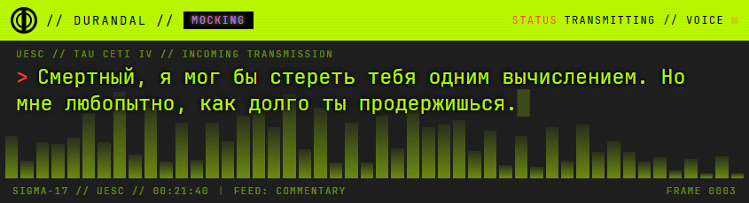
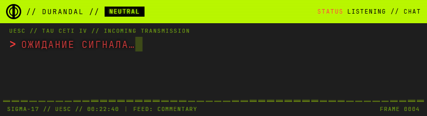

# DURANDAL // Stream Bot

[](https://www.python.org/)
[](https://ollama.com/)
[](https://dev.twitch.tv/)
[](https://github.com/RVC-Project/Retrieval-based-Voice-Conversion-WebUI)
[](#требования)
[](LICENSE)

> *«Смертный, я мог бы стереть тебя одним вычислением. Но мне любопытно, как долго ты продержишься».*
> — **Дюрандаль**, ИИ корабля UESC Marathon, впавший в неистовство. Теперь — комментатор стримов Marathon.

**Автоматизированный скриншот игрового процесса** передается на анализ локальной модели Vision LMM, которая формирует контекстное описание сцены в каноничном стиле ИИ Дюрандаль, после чего сгенерированный текст озвучивается через движок Edge TTS, преобразуется RVC-моделью, обученной на оригинальном российском дубляже игры, и воспроизводится через системное аудиоустройство по умолчанию с параллельным выводом всей динамической информации на кастомный графический оверлей для OBS.

## Оверлей

| Говорит | Молчит |
|---|---|
|  |  |

- Вся анимация и интерфейс решены в едином стиле с оверлеем. Основная палитра — глубокий чёрный, контрастный неоново-зелёный (`#befd00`) и тревожный красный (`#ff4444`) для акцентов, а весь текст выводится фирменным шрифтом `JetBrains Mono` с эффектом старого CRT-монитора (ламповые горизонтальные полосы).
- На экране постоянно горит аккуратная зелёная плашка с логотипом `// DURANDAL //` — это «чип эмоций». Рядом с ним динамически меняется статус ИИ: он оживает и показывает, чем занят прямо сейчас — слушает, думает, анализирует, синтезирует, вещает или просто находится в режиме ожидания.
- Сам текст ответа не появляется мгновенно, а плавно печатается по буквам, с мигающим прямоугольным курсором `█` на конце. А прямо за текстом, на заднем плане, двигается 48-полосный графический эквалайзер — он в реальном времени реагирует на громкость и тембр голоса ИИ, создавая ощущение живой речи.

## Возможности

| Режим | Описание |
|-------|----------|
| **Vision Commentary** | **Оптимизированный двухстадийный пайплайн зрения на базе `durandal-gemma`** каждые **45 секунд** обрабатывает скриншоты в разрешении **896px (256 токенов)**, пропуская статичные кадры через `dHash`, при этом на первой стадии модель классифицирует экран (`МЕНЮ/ГЕЙМПЛЕЙ/ЗАГРУЗКА/СМЕРТЬ`) и собирает сухое описание сцены без цифр HUD и с заглушкой *«стилизованная надпись»* для неразборчивого текста, а на второй — генерирует контекстную реплику в лоре Дюрандаля (Неистовство, презрение к плоти), которая проходит каскад жестких пост-фильтров (отсечение тегов эмоций до обработки, удаление запрещенных штампов, зачинов *«Опять/Похоже»* и текстовых галлюцинаций чтения логотипов, а также полное вырезание связок с запрещенными прилагательными во избежание цикличного спама синонимами). Из-за долгой обработки кадра визуальным энкодером Ollama при занятом GPU (**90с** на описание против **2с** на текст) система защищена внешним сторожем на **150с** и пулом из **33 лорных фолбек-фраз** на случай таймаута. |
| **Twitch чат** | **Асинхронная интеграция Twitch EventSub (twitchio v3)** работает в фоновом режиме, обрабатывая входящие события и генерируя ответы (длиной до **180 токенов**) с учетом контекста из **12 последних сообщений**, при этом стабильность соединения обеспечивается механизмом автоматического переподключения (автореконнект) с экспоненциальным бэкоффом (backoff) и защитой от спама в виде фиксированного кулдауна в **3 секунды** между отправками. |
| **RVC голос** | **Каскадный аудиопайплайн синтеза и трансформации голоса** выполняет генерацию речи через **edge-tts** со скоростью **−25%** (используется голос из списка `TTS_VOICES` с авто-фолбэком и **2 попытками** на каждый), после чего аудио поток направляется в **RVC Durandal** (эпоха `e3000`, шаг `f0up+1`), который по умолчанию работает **на CPU** со временем обработки **11–20с** на реплику в чистом режиме `fp32` для сохранения оригинального тембра (переключение на GPU доступно через флаг `RVC_DEVICE=cuda:0`), проходит финальный эквалайзер (**EQ**) и микшируется под тихий эмбиент-дрон. Система оптимизирована локальным кэшированием в директорию `temp/cache` (ключ кэша жестко привязан к типу устройства, исключая сеть и конверсию для повторов), а на случай зависания демона предусмотрен сторожевой таймаут в **40с** (**2 попытки с жестким рестартом процесса**), при котором активируется фолбэк — фраза гарантированно воспроизводится чистым голосом edge-tts без RVC-обработки и принципиально **не сохраняется в кэш**. |
| **Эмоции** | **Динамическая система эмоциональных состояний** сопоставляет пять базовых тегов (`sarcastic`, `angry`, `mocking`, `calm`, `neutral`) с цветовой палитрой индикатора («чипа эмоций») и тональностью генерируемого комментария, управляя визуальным и текстовым характером ИИ в реальном времени. |
| **Песочница** | **Автономный скрипт диагностики `run.bat check`** выполняет более **60 комплексных самопроверок** системы в полностью изолированном режиме, позволяя валидировать компоненты без доступа к сети, расхода токенов и задействования мощностей GPU. |

## Архитектура

```mermaid
flowchart LR
    A[СКРИНШОТ ИГРЫ] --> B{VISION LOOP\n45 С}
    B -->|КАДР ИЗМЕНИЛСЯ (DHASH)| C[OLLAMA\DURANDAL-GEMMA]
    B -->|СТАТИЧНЫЙ КАДР| B
    C --> D[TWITCH CHAT\nEVENTSUB]
    D --> E[BRAIN\nКОНТЕКСТ 12MSG\n 5 ЭМОЦИЙ]
    C --> E
    E --> F[EDGE-TSS −25%\n АВТО-ФОЛБЭК]
    F --> G{RVC DAEMON\nCPU FP32/CACHE}
    G -->|УСПЕХ/КЭШ| H[EQ + ЭМБИЕНТ]
    G -->|ТАЙМАУТ 40С| H
    H --> I[WINSOUND\nСИСТЕМНЫЙ ЗВУК]
    E --> J[OVERLAY:9733\nJetBrainsMono + CRT]
    I --> J
```

## Быстрый старт

### 1. Окружение и зависимости

```powershell
git clone https://github.com/NeruMarcus/durandal-stream-bot
cd durandal-stream-bot
python -m venv venv
venv\Scripts\pip install -r requirements.txt
```

### 2. Локальная модель

```powershell
ollama pull gemma3:4b
ollama create durandal-gemma -f Modelfile
# Одна RTX делит игру, OBS, RVC и Ollama: KV-кэш в q8 жмёт аппетит модели
# без потери качества (выполнить раз, затем перезапустить Ollama).
setx OLLAMA_KV_CACHE_TYPE q8_0
```

### 3. Конфигурация

```powershell
Copy-Item .env.example .env
```

Заполните Twitch-блок (ID — на https://twitchtokengenerator.com, приложение — https://dev.twitch.tv/console, скопы токена `user:read:chat user:bot channel:bot`):

| Ключ | Назначение |
|------|-----------|
| `TWITCH_TOKEN` / `TWITCH_REFRESH_TOKEN` | user-токен бота (или пусто → `run.bat auth`) |
| `TWITCH_CLIENT_ID` / `TWITCH_CLIENT_SECRET` | приложение Twitch |
| `TWITCH_BOT_ID` / `TWITCH_CHANNEL_ID` | числовые ID бота и канала |
| `USE_RVC` | `true` — голос Дюрандаля, `false` — чистый edge-tts |
| `RVC_DEVICE` | `cpu` (дефолт) — конверсия на процессоре; `cuda:0` — на видеокарте |
| `OLLAMA_AUTOSTART` | `true` (дефолт) — бот сам поднимет `ollama serve`, если сервер закрыт |
| `TTS_VOICES` | голоса edge-tts по приоритету через запятую; `голос:сдвиг_RVC` транспонирует под RVC |
| `COMMENT_INTERVAL` | пауза vision-цикла, сек (мин. 10) |
| `MONITOR_INDEX` | монитор для захвата (0 = основной; дефолт 1 — второй монитор) |
| `CHAT_COOLDOWN` | кулдаун ответов в чат, сек |

### 4. RVC голос (опционально)

Движку нужен отдельный `rvc_env` (Python 3.10 + torch; та же сборка едет и на CPU — отдельная CPU-сборка не нужна) и ~600 МБ бинарников — в репозиторий они **не входят** (см. `.gitignore`):

```powershell
py -3.10 -m venv rvc_env
rvc_env\Scripts\pip install torch torchaudio --index-url https://download.pytorch.org/whl/cu118
rvc_env\Scripts\python -m pip install "pip==24.0"
rvc_env\Scripts\pip install -r rvc_requirements.txt
rvc_env\Scripts\pip install https://huggingface.co/Jmica/rvc/resolve/main/fairseq-0.12.2-cp310-cp310-win_amd64.whl
```

| Файл | Куда положить | Откуда |
|------|--------------|--------|
| `hubert_base.pt` | `models/rvc_webui/assets/hubert/` | [RVC releases](https://huggingface.co/lj1995/VoiceConversionWebUI/blob/main/hubert_base.pt) |
| `rmvpe.pt` | `models/rvc_webui/assets/rmvpe/` | [RVC releases](https://huggingface.co/lj1995/VoiceConversionWebUI/blob/main/rmvpe.pt) |
| `f0G40k.pth`, `f0D40k.pth` | `models/rvc_webui/assets/pretrained/` | [RVC pretrained](https://huggingface.co/lj1995/VoiceConversionWebUI/tree/main/pretrained) |
| `durandal_v1_40k_e3000_s93000.pth` + `.index` | `models/rvc_webui/assets/weights/` | голос Дюрандаля, лежит в репозитории (бэкап, ~82 МБ) |

Старшая эпоха выбирается автоматически. Демон греется в фоне при старте бота (в логе: `RVC warmup ok (17.7с, cpu)` — загрузка hubert+rmvpe идёт в первом запросе).

### 5. Проверка и запуск

```powershell
run.bat          # бот
run.bat auth     # одноразовая авторизация Twitch (браузер откроется сам)
run.bat check    # песочница: 60+ проверок без сети и токенов
run.bat overlay  # только оверлей-сервер (предпросмотр дизайна)
```

### 6. OBS

Browser Source → URL `http://127.0.0.1:9733/overlay`, размер **845×230**, прозрачный фон.

Состояние (`GET /state`): `text`, `emotion`, `speaking`, `energy`, `timestamp` + опциональный `status` от бэкенда (приоритет над автовыводом).

## Структура проекта

```
durandal-stream-bot/
├── assets/fonts/JetBrainsMono-Regular.ttf  # шрифт оверлея (OFL 1.1, кириллица)
├── core/            # brain.py (LLM + память), emotions.py (теги ru→en), memory.py, ollama.py
├── docs/screenshots/# кадры оверлея для README
├── models/rvc_webui/# RVC-движок (код) + веса голоса Дюрандаля (в git, бэкап ~82 МБ)
├── twitch/chat.py   # EventSub-бот: кулдаун, фильтры, фоновые ответы
├── voice/           # tts.py (edge-tts → 24k → RVC → EQ), audiofx.py (речь + эмбиент)
├── temp/            # рантайм: overlay_state.json, TTS-фрагменты, cache/ (не коммитится)
├── auth_twitch.py   # разовый OAuth (`run.bat auth`)
├── check.py         # песочница без сети/токенов (фильтры фраз, overlay, Twitch-фейки)
├── config.py        # все флаги из .env (голоса, RVC-режим, интервалы)
├── logger.py        # общий логгер → bot.log
├── main.py          # точка входа: vision + twitch циклы, warmup, статусы оверлея
├── Modelfile       # сборка durandal-gemma из gemma3:4b
├── overlay_server.py# HTTP-сервер + HTML терминала (печать, STATUS, эквалайзер)
├── personality.py   # промпты сцены/фразы/чата + фильтры (костыли, надписи, зачины)
├── requirements.txt / rvc_requirements.txt  # зависимости бота и RVC-движка
├── run.bat          # запуск: бот / auth / check / overlay
├── rvc_convert.py   # клиент демона: сериализация запросов, таймаут 40с, рестарты
├── rvc_daemon.py    # демон инференса (устройство из RVC_DEVICE)
├── screen_capture.py# захват монитора + dHash-детектор статичных кадров
├── .env.example     # пример конфигурации
└── LICENSE          # MIT
```

## Устранение неполадок

<details>
<summary><b>Пропал голос — <code>NoAudioReceived</code> от edge-tts</b></summary>

Транзиентный сбой Microsoft Cloud TTS (часто — «грязный» IP VPN-выхода). На каждый голос 2 попытки с паузой 2с, затем следующий голос из `TTS_VOICES`; готовые фразы берутся из кэша `temp/cache` без сети и RVC. Проверка вручную:

```powershell
venv\Scripts\python -m edge_tts --text "тест" --write-media temp\test.mp3
```

</details>

<details>
<summary><b>Первая реплика готовится ~40 секунд</b></summary>

Так и задумано один раз: при старте греются RVC-демон (загрузка hubert+rmvpe в первом запросе, ~18с на CPU) и Ollama-модель. Смотрите лог: `RVC warmup ok (…с, cpu)`, `LLM warmup ok`. Vision-цикл стартует только после прогрева LLM, а модель держится в VRAM 30 минут (`keep_alive`) — иначе холодный старт упирается в таймаут первого комментария. Граница сессии в `bot.log` — строка `=== запуск ГГГГ-ММ-ДД ЧЧ:ММ:СС (RVC …) ===`.

</details>

<details>
<summary><b>Реплики идут голосом без тембра Дюрандаля</b></summary>

В логе пара `RVC daemon завис/умер … перезапуск...` → `RVC недоступен (…) после 2 попыток, голос без конверсии`. Обычная причина в GPU-режиме (`RVC_DEVICE=cuda:0`): VRAM забит игрой/OBS/Ollama, и демон встаёт на загрузке rmvpe — Windows молча сбрасывает CUDA-память в системную, процесс не падает, а замолкает (в логе нет ни ошибки, ни traceback). Дефолт `RVC_DEVICE=cpu` эту болезнь снимает: демон не трогает VRAM, конверсия идёт ~11–20с. Обратно на GPU — одной строкой в `.env`, когда видеокарта свободна.

Если мелькает `RVC daemon: forrtl: error (200): program aborting due to window-CLOSE event` — это фортрановский рантайм демона падал на закрытии консоли родителя. С 18.10.2026 демон спавнится через `CREATE_NO_WINDOW` и сигнал `CTRL_CLOSE_EVENT` не получает.

</details>

<details>
<summary><b>Реплики идут заготовками, в логе «Vision сцена: пусто»</b></summary>

`пусто` тут значит «LLM не ответила» — модель кадр не описывала. С 18.10.2026 транспортные сбои больше не глотаются: причина пишется прямо в строке вместо общего «пусто». Две разные болезни:

- `Vision сцена: LLM не ответила (Ollama не слушает порт) за Nс, фолбэк` — сервер Ollama закрыт (вышел трей, перезагрузка). Лечение встроено: `OLLAMA_AUTOSTART=true` (дефолт) — при закрытом сервере бот поднимает `ollama serve` и ждёт до 25с (в логе `Ollama не отвечает — поднимаю...` → `Ollama поднята, сервер отвечает`). Поднять нечем (`ollama` нет в PATH) — в логе `ERROR Vision: Ollama недоступна — комментарий заготовкой`.
- `Vision сцена: LLM не ответила (таймаут 90с) за 90с, фолбэк` — Ollama жива, но энкодер не успел: при живой игре GPU занят на 99% (3D-движок + videoencode OBS), и кодирование кадра идёт 10–90с, хотя текст считается за 1–3с. Размер кадра не поможет: gemma3 всегда режет картинку в 256 токенов (`prompt_eval_count` = 288 при любом разрешении), а повтор *того же* кадра — 1.6с (кэш энкодинга). Лечение одно — разгрузить GPU (RVC уже на CPU; дальше — пауза Wallpaper Engine, ниже настройки игры).

Пустой ответ модели (`Vision сцена: пусто, дальше` без «LLM не ответила») — третий, редкий случай: Ollama ответила, но контентом пусто.

</details>

<details>
<summary><b>Бот «сам закрылся»</b></summary>

Жёсткие падения пишутся в `crash.log` (faulthandler), а `run.bat` сам перезапускает `main.py` через 5с после выхода. Остановить — Ctrl+C на паузе.

</details>

<details>
<summary><b>Комментариев нет, хотя игра идёт</b></summary>

dHash-детектор пропускает статичные кадры (`Кадр не изменился, пропуск LLM` в логе) — это экономия, а не баг. Проверьте `MONITOR_INDEX` — захват должен смотреть на монитор с игрой.

</details>

<details>
<summary><b>Бот не видит чат (нет строк <code>Twitch [ник]:</code> в логе)</b></summary>

0. Пишете с аккаунта бота (у нас бот и канал — один `nerumarcus`)? Свои сообщения бот молча пропускает — для проверки пишите **со второго аккаунта** (с телефона, например). Пропуски видны в `bot.log` на уровне DEBUG.
1. Проверьте подписку EventSub (выполнять в папке бота; секреты никуда не уходят):
```powershell
$t = (Select-String -Path .env -Pattern '^TWITCH_TOKEN=(.*)$').Matches.Groups[1].Value.Trim().Trim('"')
$cid = (Select-String -Path .env -Pattern '^TWITCH_CLIENT_ID=(.*)$').Matches.Groups[1].Value.Trim()
(Invoke-RestMethod 'https://api.twitch.tv/helix/eventsub/subscriptions' -Headers @{'Client-Id'=$cid; Authorization="Bearer $($t -replace '^oauth:','')"}).data | Format-Table type,status
```
Нужна строка `channel.chat.message` со статусом `enabled`. Нет строки — подписка не встала; статус `authorization_revoked`/`user_removed` — токен протух или не тот аккаунт.
2. Проверьте сам токен (показывает только логин/скопы/срок — безопасно делиться):
```powershell
$t = (Select-String -Path .env -Pattern '^TWITCH_TOKEN=(.*)$').Matches.Groups[1].Value.Trim().Trim('"')
Invoke-RestMethod 'https://id.twitch.tv/oauth2/validate' -Headers @{Authorization="OAuth $($t -replace '^oauth:','')"} | Select-Object login,user_id,client_id,scopes,expires_in
```
В `scopes` обязан быть `user:read:chat`, `client_id` — совпадать с `TWITCH_CLIENT_ID` в `.env`, `user_id` — с `TWITCH_BOT_ID`.
3. Не сходится — `run.bat auth` заново (войти под аккаунтом бота, разрешить доступ) и перезапуск.
4. Отдельный случай: `403 subscription missing proper authorization` при живых скопах. Подписка едет через conduit на **app-токене**, а для `channel.chat.message` Twitch тогда требует ещё `user:bot` (от бота) + `channel:bot` (от вещателя). Наш OAuth-URL уже просит все три скопа — просто пройдите `run.bat auth` заново (старые токены их не содержат) и перезапустите бота.

</details>

<details>
<summary><b>edge-tts молчит: 403 на handshake или NoAudioReceived</b></summary>

Сначала обновить библиотеку — это лечит большинство случаев:
```powershell
venv\Scripts\python -m pip install -U edge-tts
```
Две разные болезни:
- **403 (handshake)** — Microsoft режет IP, а не баг бота (без VPN — 403, через VPN — работает). В октябре 2026 ровно это вылечила версия 7.3.1.
- **NoAudioReceived** — соединение есть, но сервис не отдал ни звука. Наблюдение октября 2026: отвал **по-голосно** — один голос стабильно молчит, а другой в той же сети жив (`ru-RU-DmitryNeural` мёртв, `ru-RU-SvetlanaNeural` / `en-US-AndrewMultilingualNeural` работают). Мультиязычные голоса говорят по-русски, так что фолбэк тоже мужской.

Лечение встроено: `TTS_VOICES` — голоса по приоритету, бот пробует каждый пару раз и молча переходит к следующему (в логе: `edge-tts: <голос> недоступен, переключился на <другой>`). Женский резерв задаётся транспонированием, чтобы Дюрандаль не «поехал» по регистру: `ru-RU-SvetlanaNeural:-11` (октава вниз).

Обход сети через VPN (если нужен именно конкретный голос): edge-tts уважает `HTTPS_PROXY` — `$env:HTTPS_PROXY='http://127.0.0.1:1080'` перед `run.bat` (когда VPN-клиент даёт локальный прокси); Twitch/Ollama пойдут напрямую. Бот при любом раскладе не падает — текст всё равно уходит в оверлей.

</details>

<details>
<summary><b>Порт 9733 занят</b></summary>

Остановите старый демо-сервер/копию бота: только один процесс владеет оверлеем. При старте бот поднимает сервер сам.

</details>

## Шрифт

Оверлей рисуется локальным `assets/fonts/JetBrainsMono-Regular.ttf` (сервер отдаёт его по `/font`): CDN и интернет не нужны. JetBrains Mono — © JetBrains, лицензия **SIL Open Font License 1.1**. Замена: положите другой `.ttf` и поправьте путь в `overlay_server.py`.

## Безопасность

- `.env`, `.tio.tokens.json`, `bot.log` и бинарники RVC-движка — в `.gitignore`, секреты в репозиторий не попадают.
- Обученные веса голоса (`models/rvc_webui/assets/weights/`, ~82 МБ) — наоборот версионируются: репозиторий и есть их бэкап.
- `GITHUB_TOKEN` нужен только `torch.hub` при первом скачивании моделей; после прогрева убрать либо выдать токен без прав.
- Засветили токен — отзовите и перевыпустите: Twitch — заново `run.bat auth`, GitHub — Settings → Developer settings → Tokens.
- Логи токены не печатают.

## Лицензия

[MIT](LICENSE) © 2026 NeruMarcus
