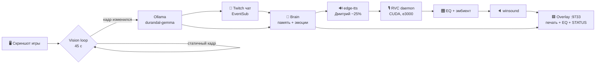

# DURANDAL // Stream Bot

[](https://www.python.org/)
[](https://ollama.com/)
[](https://dev.twitch.tv/)
[](https://github.com/RVC-Project/Retrieval-based-Voice-Conversion-WebUI)
[](#требования)
[](LICENSE)

> *«Смертный, я мог бы стереть тебя одним вычислением. Но мне любопытно, как долго ты продержишься».*
> — **Дюрандаль**, ИИ корабля UESC Marathon, впавший в Rampancy. Теперь — комментатор стримов Marathon.

Скриншот игры → локальный vision LLM → язвительный комментарий → синтез речи → голос Дюрандаля → OBS-оверлей в стиле терминалов Marathon 2026. Без облачных LLM, без VPN, без подписок.

## Оверлей

| Говорит | Молчит |
|---|---|
|  |  |

- Зелёная плашка `// DURANDAL //` с логотипом, чип эмоции, живой `STATUS`: `TRANSMITTING` / `RENDERING` / `ANALYZING` / `THINKING` / `SYNTHESIZING` / `LISTENING` / `STANDBY`
- Текст **печатается по буквам**, как терминал, с курсором `█`
- За текстом — 48-полосный эквалайзер от **реальной громкости** голоса
- Шрифт JetBrains Mono зашит локально (кириллица, офлайн), CRT-сканлайны, палитра `#befd00` / `#ff4444` / `#000` — общий язык с оверлеями `overlay/MRTHN/WEB`

## Возможности

| Режим | Описание |
|-------|----------|
| **Vision commentary** | Каждые 45 с смотрит скриншот; статичный кадр пропускается без LLM-вызова (dHash). Локальная `durandal-gemma` → фолбек-фразы |
| **Twitch чат** | EventSub (twitchio v3), автореконнект с бэкоффом, кулдаун 3 с, ответы в фоне, контекст 20 сообщений |
| **RVC голос** | edge-tts (Дмитрий, −25%) → RVC Durandal (e3000, f0up+1) → EQ → тихий эмбиент-дрон |
| **Эмоции** | `sarcastic / angry / mocking / calm / neutral` — цвет чипа и тон комментария |
| **Песочница** | `run.bat check` — 60+ самопроверок без сети, токенов и GPU |

## Архитектура



## Быстрый старт

### 1. Окружение и зависимости

```powershell
git clone https://github.com/NeruMarcus/durandal-stream-bot
cd durandal-stream-bot
python -m venv venv
venv\Scripts\pip install -r requirements.txt
```

### 2. Локальная модель

```powershell
ollama pull gemma3:4b
ollama create durandal-gemma -f Modelfile
```

### 3. Конфигурация

```powershell
Copy-Item .env.example .env
```

Заполните Twitch-блок (ID — на https://twitchtokengenerator.com, приложение — https://dev.twitch.tv/console, скопы токена `user:read:chat user:bot channel:bot`):

| Ключ | Назначение |
|------|-----------|
| `TWITCH_TOKEN` / `TWITCH_REFRESH_TOKEN` | user-токен бота (или пусто → `run.bat auth`) |
| `TWITCH_CLIENT_ID` / `TWITCH_CLIENT_SECRET` | приложение Twitch |
| `TWITCH_BOT_ID` / `TWITCH_CHANNEL_ID` | числовые ID бота и канала |
| `USE_RVC` | `true` — голос Дюрандаля, `false` — чистый edge-tts |
| `COMMENT_INTERVAL` | пауза vision-цикла, сек (мин. 10) |
| `MONITOR_INDEX` | монитор для захвата (0 = основной) |
| `CHAT_COOLDOWN` | кулдаун ответов в чат, сек |

### 4. RVC голос (опционально)

Движку нужен отдельный `rvc_env` (Python 3.10 + torch CUDA) и ~600 МБ бинарников — в репозиторий они **не входят** (см. `.gitignore`):

```powershell
py -3.10 -m venv rvc_env
rvc_env\Scripts\pip install torch torchaudio --index-url https://download.pytorch.org/whl/cu118
rvc_env\Scripts\python -m pip install "pip==24.0"
rvc_env\Scripts\pip install -r rvc_requirements.txt
rvc_env\Scripts\pip install https://huggingface.co/Jmica/rvc/resolve/main/fairseq-0.12.2-cp310-cp310-win_amd64.whl
```

| Файл | Куда положить | Откуда |
|------|--------------|--------|
| `hubert_base.pt` | `models/rvc_webui/assets/hubert/` | [RVC releases](https://huggingface.co/lj1995/VoiceConversionWebUI/blob/main/hubert_base.pt) |
| `rmvpe.pt` | `models/rvc_webui/assets/rmvpe/` | [RVC releases](https://huggingface.co/lj1995/VoiceConversionWebUI/blob/main/rmvpe.pt) |
| `f0G40k.pth`, `f0D40k.pth` | `models/rvc_webui/assets/pretrained/` | [RVC pretrained](https://huggingface.co/lj1995/VoiceConversionWebUI/tree/main/pretrained) |
| `durandal_v1_40k_e3000_s93000.pth` + `.index` | `models/rvc_webui/assets/weights/` | голос Дюрандаля, лежит в репозитории (бэкап, ~82 МБ) |

Старшая эпоха выбирается автоматически. Демон греется в фоне при старте бота.

### 5. Проверка и запуск

```powershell
run.bat          # бот
run.bat auth     # одноразовая авторизация Twitch (браузер откроется сам)
run.bat check    # песочница: 60+ проверок без сети и токенов
run.bat overlay  # только оверлей-сервер (предпросмотр дизайна)
run.bat piper    # докачка и проверка офлайн-голоса Piper
```

### 6. OBS

Browser Source → URL `http://127.0.0.1:9733/overlay`, размер **845×230**, прозрачный фон.

Состояние (`GET /state`): `text`, `emotion`, `speaking`, `energy`, `timestamp` + опциональный `status` от бэкенда (приоритет над автовыводом).

## Структура проекта

```
durandal-stream-bot/
├── assets/fonts/JetBrainsMono-Regular.ttf  # шрифт оверлея (OFL 1.1, кириллица)
├── core/            # brain.py (LLM + память), emotions.py (теги ru→en), memory.py, ollama.py
├── docs/screenshots/# кадры оверлея для README
├── models/rvc_webui/# RVC-движок (код; бинарники качаются отдельно — см. §RVC голос)
├── twitch/chat.py   # EventSub-бот: кулдаун, фильтры, фоновые ответы
├── voice/           # tts.py (edge-tts → 24k → RVC → EQ), piper_tts.py (офлайн-фолбэк), audiofx.py (речь + эмбиент)
├── temp/            # рантайм: overlay_state.json, TTS-фрагменты (не коммитится)
├── main.py          # точка входа: vision + twitch циклы, warmup, статусы оверлея
├── overlay_server.py# HTTP-сервер + HTML терминала (печать, STATUS, эквалайзер)
├── check.py         # песочница без сети/токенов
├── Modelfile       # сборка durandal-gemma из gemma3:4b
└── run.bat          # запуск: бот / auth / check / overlay
```

## Устранение неполадок

<details>
<summary><b>Пропал голос — <code>NoAudioReceived</code> от edge-tts</b></summary>

Транзиентный сбой Microsoft Cloud TTS (часто — «грязный» IP VPN-выхода). Бот делает 4 попытки с нарастающей паузой, текст всё равно уходит в оверлей. Проверка вручную:

```powershell
venv\Scripts\python -m edge_tts --text "тест" --write-media temp\test.mp3
```

</details>

<details>
<summary><b>Первая реплика готовится ~40 секунд</b></summary>

Так и задумано один раз: при старте греются RVC-демон (загрузка модели в VRAM) и Ollama-модель. Смотрите лог: `RVC warmup ok`, `LLM warmup ok`.

</details>

<details>
<summary><b>Комментариев нет, хотя игра идёт</b></summary>

dHash-детектор пропускает статичные кадры (`Кадр не изменился, пропуск LLM` в логе) — это экономия, а не баг. Проверьте `MONITOR_INDEX` — захват должен смотреть на монитор с игрой.

</details>

<details>
<summary><b>Бот не видит чат (нет строк <code>Twitch [ник]:</code> в логе)</b></summary>

1. Проверьте подписку EventSub (выполнять в папке бота; секреты никуда не уходят):
```powershell
$t = (Select-String -Path .env -Pattern '^TWITCH_TOKEN=(.*)$').Matches.Groups[1].Value.Trim().Trim('"')
$cid = (Select-String -Path .env -Pattern '^TWITCH_CLIENT_ID=(.*)$').Matches.Groups[1].Value.Trim()
(Invoke-RestMethod 'https://api.twitch.tv/helix/eventsub/subscriptions' -Headers @{'Client-Id'=$cid; Authorization="Bearer $($t -replace '^oauth:','')"}).data | Format-Table type,status
```
Нужна строка `channel.chat.message` со статусом `enabled`. Нет строки — подписка не встала; статус `authorization_revoked`/`user_removed` — токен протух или не тот аккаунт.
2. Проверьте сам токен (показывает только логин/скопы/срок — безопасно делиться):
```powershell
$t = (Select-String -Path .env -Pattern '^TWITCH_TOKEN=(.*)$').Matches.Groups[1].Value.Trim().Trim('"')
Invoke-RestMethod 'https://id.twitch.tv/oauth2/validate' -Headers @{Authorization="OAuth $($t -replace '^oauth:','')"} | Select-Object login,user_id,client_id,scopes,expires_in
```
В `scopes` обязан быть `user:read:chat`, `client_id` — совпадать с `TWITCH_CLIENT_ID` в `.env`, `user_id` — с `TWITCH_BOT_ID`.
3. Не сходится — `run.bat auth` заново (войти под аккаунтом бота, разрешить доступ) и перезапуск.
4. Отдельный случай: `403 subscription missing proper authorization` при живых скопах. Подписка едет через conduit на **app-токене**, а для `channel.chat.message` Twitch тогда требует ещё `user:bot` (от бота) + `channel:bot` (от вещателя). Наш OAuth-URL уже просит все три скопа — просто пройдите `run.bat auth` заново (старые токены их не содержат) и перезапустите бота.

</details>

<details>
<summary><b>edge-tts отвечает 403 (Microsoft режет IP)</b></summary>

Библиотека свежая, 4 ретрая не помогают — это сетевой блок со стороны Microsoft, а не баг бота (без VPN — 403 на handshake, через VPN — работает). Бот при этом не падает: текст всё равно уходит в оверлей, цикл продолжается.
- Быстрое лечение: поднять VPN и гнать через него хотя бы TTS. edge-tts уважает `HTTPS_PROXY`, так что можно точечно: `$env:HTTPS_PROXY='http://127.0.0.1:1080'` перед `run.bat` (если VPN-клиент даёт локальный прокси) — остальное (Twitch, Ollama) пойдёт напрямую.
- Встроенное: **офлайн-фолбэк Piper**. После 4 неудачных попыток edge-tts бот сам синтезирует реплику локальным Piper (`ru-RU dmitri/medium`, MIT) и гонит её по тому же пайплайну (24k → RVC → EQ → эмбиент). Тембр всё равно переозвучивает RVC. Движок и голос (~85 МБ на диктора) докачиваются сами при первом использовании в `vendor/piper/` (в git не входит); прогрев вручную: `run.bat piper`. Темп речи — `LENGTH_SCALE` + `ATEMPO` в `voice/piper_tts.py`. Диктор — `PIPER_VOICE` в `.env`: `ruslan` (по умолчанию, ниже), `dmitri`, `denis`, `irina`.

</details>

<details>
<summary><b>Порт 9733 занят</b></summary>

Остановите старый демо-сервер/копию бота: только один процесс владеет оверлеем. При старте бот поднимает сервер сам.

</details>

## Шрифт

Оверлей рисуется локальным `assets/fonts/JetBrainsMono-Regular.ttf` (сервер отдаёт его по `/font`): CDN и интернет не нужны. JetBrains Mono — © JetBrains, лицензия **SIL Open Font License 1.1**. Замена: положите другой `.ttf` и поправьте путь в `overlay_server.py`.

## Безопасность

- `.env`, `.tio.tokens.json`, `bot.log` и бинарники RVC-движка — в `.gitignore`, секреты в репозиторий не попадают.
- Обученные веса голоса (`models/rvc_webui/assets/weights/`, ~82 МБ) — наоборот версионируются: репозиторий и есть их бэкап.
- `GITHUB_TOKEN` нужен только `torch.hub` при первом скачивании моделей; после прогрева убрать либо выдать токен без прав.
- Засветили токен — отзовите и перевыпустите: Twitch — заново `run.bat auth`, GitHub — Settings → Developer settings → Tokens.
- Логи токены не печатают.

## Лицензия

[MIT](LICENSE) © 2026 NeruMarcus
